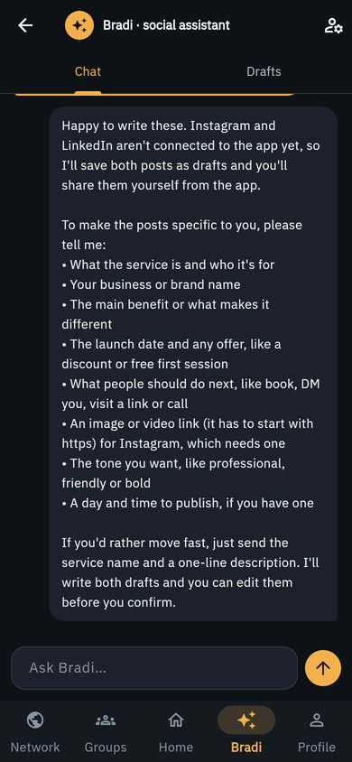
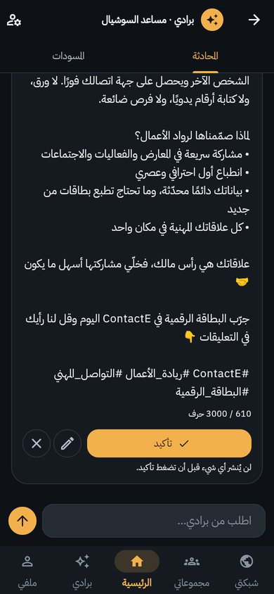
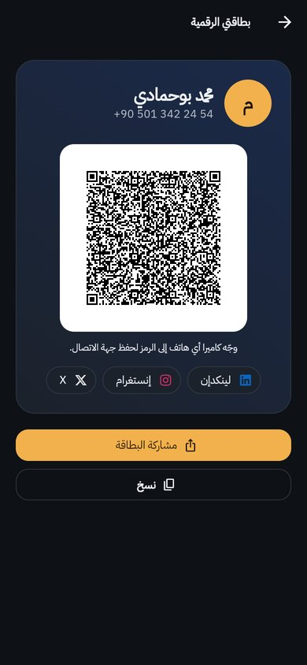
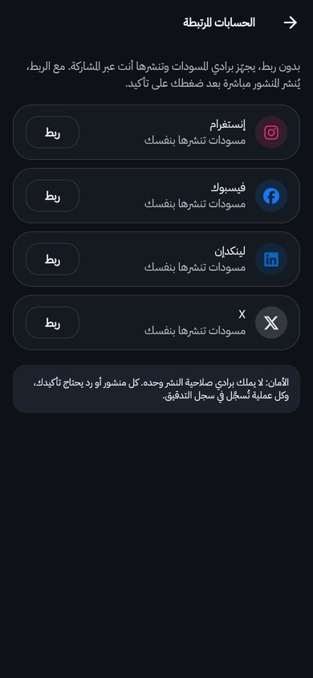

# ContactE

**Your contacts, your network and your social accounts in one app — with an AI assistant that drafts, and you decide.**

ContactE is a Flutter app (Arabic-first, right-to-left) for managing contacts, groups and your professional
network on Firebase. The 2026 version adds **Bradi**, an AI agent that helps you run your Instagram,
Facebook, LinkedIn and X accounts, a **digital business card** anyone can scan, and a Material 3 redesign.

> **عربي باختصار:** تطبيق Flutter لإدارة جهات الاتصال والمجموعات والشبكة المهنية، ومعه **برادي**: مساعد ذكي
> يكتب منشوراتك لإنستغرام وفيسبوك ولينكدإن وX ويقترح الردود والأوقات — ولا يُنشر شيء قبل أن تؤكده أنت.
> وفيه **بطاقة رقمية** برمز QR تحفظ جهة اتصالك في أي هاتف بمجرد توجيه الكاميرا إليها.

| Bradi, the social-media agent | Drafts wait for your confirmation | Digital business card | Connected accounts |
|---|---|---|---|
|  |  |  |  |

---

## Features

### Bradi — AI agent for your social accounts
- Writes posts and adapts one idea for each platform (length, tone, hashtags).
- Suggests a publishing time and schedules confirmed posts.
- Reads recent comments on Instagram and Facebook and drafts replies.
- Answers in Arabic, French, English or Turkish.

**The model drafts, code decides, you confirm.**

- Every action the AI takes creates a *draft*. Nothing is published or sent until you tap **Confirm**;
  you can edit or reject any draft first.
- Platform rules are checked in code before a draft is saved and again before it is sent
  (X 280 characters, Instagram needs an image and at most 30 hashtags, LinkedIn 3,000 characters…).
- Without a connected account, a confirmed draft opens your phone's share sheet so you post it yourself.
  With a connected account, it is published through the platform's official API.
- Every step is written to an audit log.

### Digital business card
A QR code that holds a standard **vCard** (name, phone, email, social links). Any phone camera can scan it
and save you as a contact — the other person does not need ContactE. You can also share or copy the card.

### Contacts and network
Contacts with social profiles, groups, your network, friend suggestions based on shared interests, and
search by phone number — all synced with Firebase.

### Design
Material 3, dark-first design tokens, **IBM Plex Sans Arabic**, right-to-left layouts, a labelled
navigation bar and quick actions on the home screen.

---

## Architecture

```
Flutter app (lib/)                         agent_backend/ (FastAPI)                  Platforms
┌──────────────────────────┐   HTTPS +     ┌──────────────────────────────┐          ┌───────────────┐
│ Screens · design system  │ Firebase ID   │ Auth: verifies the ID token  │  only    │ Meta Graph    │
│ Bradi chat · draft cards │ ────────────► │ Agent: Claude + tool calling │ after    │ (IG, FB)      │
│ Digital card (vCard QR)  │   token       │   tools only create drafts   │ Confirm  │ LinkedIn API  │
│ Firebase Auth/Firestore  │               │ Rules · audit log · scheduler│ ───────► │ X API v2      │
└──────────────────────────┘               │ Tokens encrypted at rest     │          └───────────────┘
                                           └──────────────────────────────┘
```

- **No secrets in the app.** The Claude API key and the users' social-media tokens live only on the server;
  the app sends the signed-in user's Firebase ID token.
- The backend's tools are read-only or create pending drafts; publishing happens only through
  `POST /proposals/{id}/confirm`, which the app calls when you tap Confirm.
- Details, API and platform setup: [`agent_backend/README.md`](agent_backend/README.md).

### Project structure

| Path | What it holds |
|---|---|
| `lib/design/` | Design tokens and the Material 3 theme |
| `lib/features/agent/` | Bradi: API client, chat screen, draft cards, connected accounts |
| `lib/features/card/` | Digital business card and vCard builder |
| `lib/screens/`, `lib/shared/` | Contacts, groups, network, profile, onboarding, shared widgets |
| `lib/services/` | Firebase services and models |
| `lib/main_preview.dart` | Design preview of the new screens that runs without Firebase |
| `agent_backend/` | FastAPI + Claude agent service, with tests |
| `test/` | Widget and unit tests |

---

## Getting started

### Requirements
- Flutter stable (tested with 3.47.7, Dart 3.13)
- A Firebase project (Auth + Cloud Firestore)
- Python 3.11+ for the agent backend, and a Claude API key
- On Windows, enable **Developer Mode** (Settings → System → For developers) — Flutter needs symlink
  support to build apps with plugins

### 1. Run the app
```bash
flutter pub get
flutter run --dart-define=AGENT_BASE_URL=http://10.0.2.2:8090   # Android emulator → local backend
```
Firebase is configured for Android, iOS, macOS and Windows in `lib/firebase_options.dart`. For the web,
run `flutterfire configure` to add a web app.

### 2. Run the agent backend
```bash
cd agent_backend
pip install -r requirements.txt
cp .env.example .env    # set ANTHROPIC_API_KEY and TOKEN_ENCRYPTION_KEY
uvicorn app.main:app --port 8090
```

### 3. Design preview (no Firebase)
```bash
# agent_backend/.env: AUTH_MODE=dev, CORS_ORIGINS=http://localhost:8091
flutter run -d chrome -t lib/main_preview.dart \
  --dart-define=AGENT_BASE_URL=http://localhost:8090 --dart-define=AGENT_DEV_USER=preview-user
```
The development user header is ignored in release builds.

### Connecting real social accounts
Without connecting anything, Bradi works in **drafts** mode on every platform. Direct publishing needs a
developer app on each platform (Meta, LinkedIn, X — posting on X requires a paid API tier) and the user's
access token; see the table in [`agent_backend/README.md`](agent_backend/README.md#connecting-real-accounts).

---

## Testing

```bash
flutter test                          # 6 widget/unit tests: vCard, agent chat, confirm-only publishing,
                                      # error display, card rendering
cd agent_backend && pytest            # 14 tests: platform rules, agent loop, connectors, auth, scheduler
```
The backend tests use a scripted model and mocked platform APIs: no network and no API key needed.

---

## Security notes
- No API keys ship inside the app.
- Social-media tokens are encrypted at rest on the server and never returned to the app.
- Users can only see and confirm their own drafts.
- Development authentication works only from `localhost` and only when `AUTH_MODE=dev`.

## Roadmap
- OAuth sign-in flows for each platform (today a token is entered once on the Connected accounts screen)
- Redesign the remaining legacy screens with the new components
- Firebase web configuration for a full web build

## Tech stack
Flutter · Dart · Material 3 · Firebase Auth & Cloud Firestore · FastAPI · Claude (Anthropic API) ·
Meta Graph API · LinkedIn API · X API v2 · qr_flutter · share_plus

<details>
<summary>Earlier version (2024)</summary>


</details>

---

Made by [Mohamd Bouhemadi](https://talebbouhemadi.com) · mohamdahmed@talebbouhemadi.com
